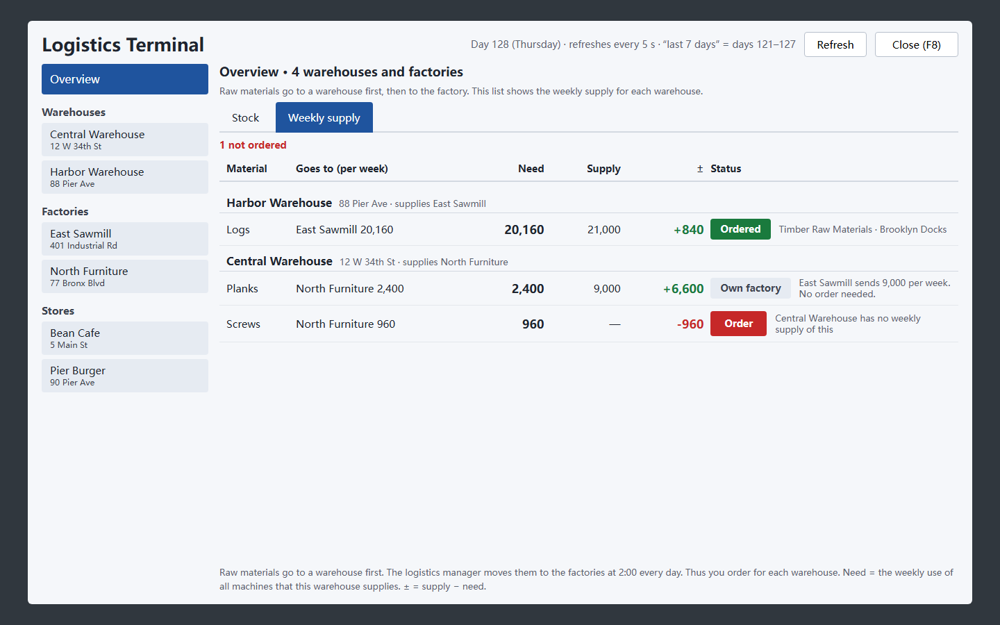
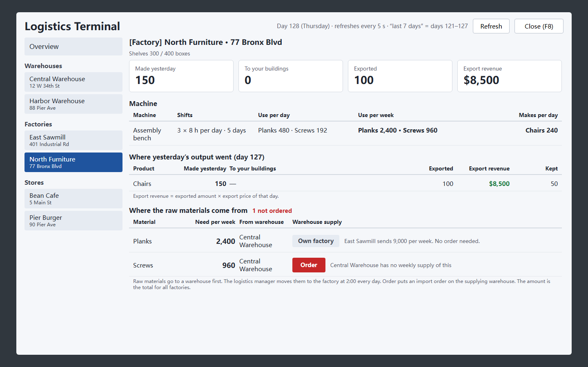
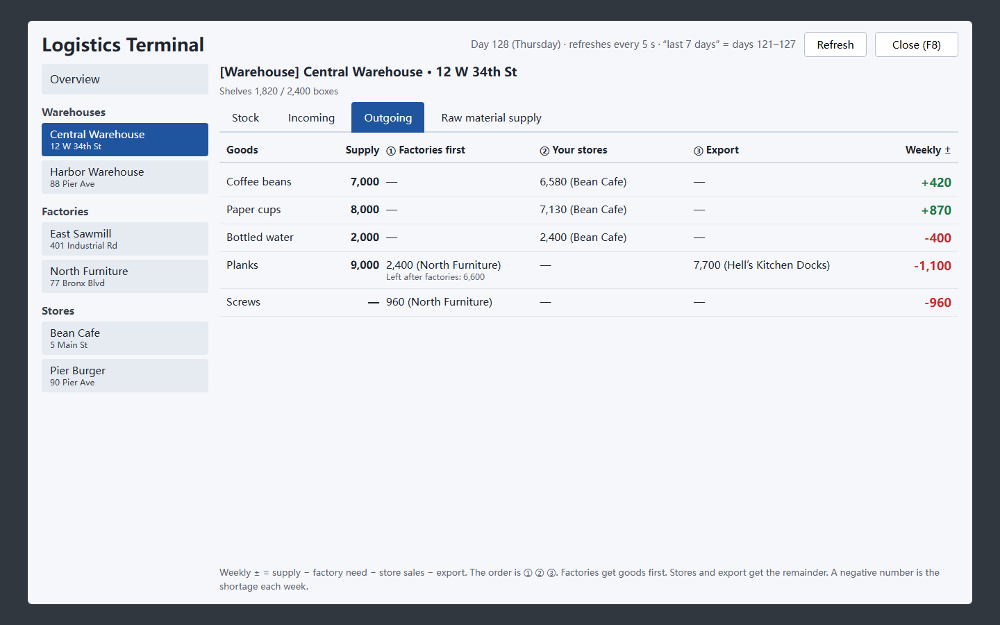
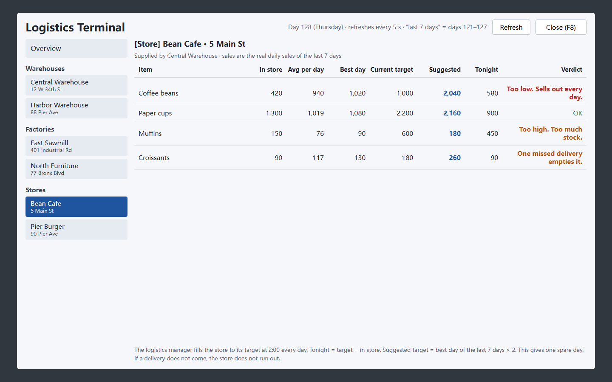
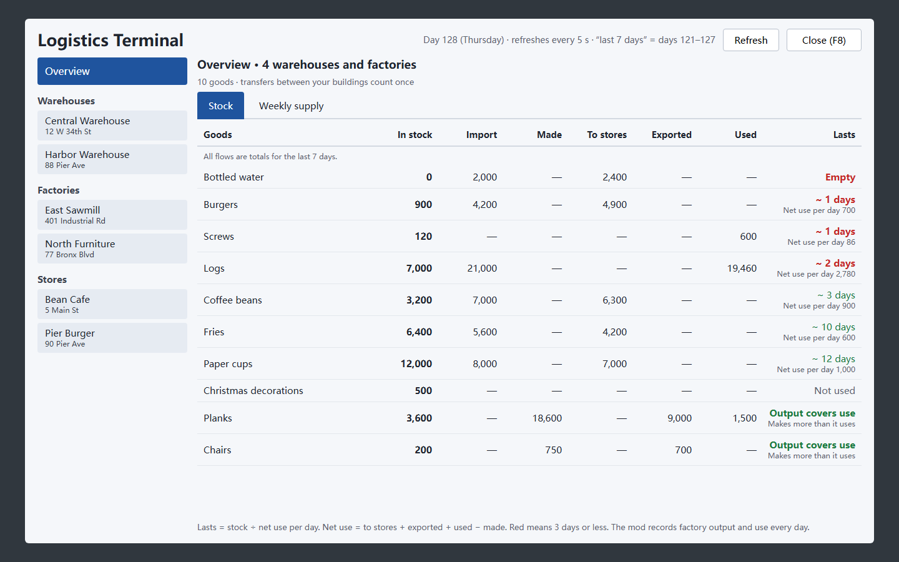
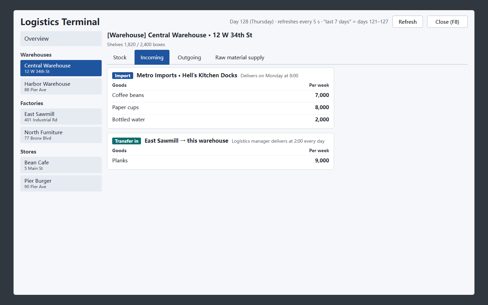

# Logistics Terminal for Big Ambitions

**English** | [简体中文](README.zh-CN.md)

Logistics Terminal is a mod for [Big Ambitions](https://store.steampowered.com/app/1331550/Big_Ambitions/). It adds an app to the in-game phone. The app shows your full supply chain on one screen.

The app shows:

- The stock in each warehouse and factory.
- The source and the destination of your goods.
- The raw materials that each factory needs each week.
- The sales of each store.

The app can also change import amounts and store restock targets with one click.

The app text uses the game language. If the game language is Chinese, the app shows Chinese. For all other languages, the app shows English.

## Screenshots

The screenshots come from the design mockup. The data is not real. The in-game window has the same layout.

| Weekly supply for each warehouse | Factory dashboard |
|---|---|
|  |  |

| Warehouse: outgoing goods | Store restock |
|---|---|
|  |  |

| Stock overview | Warehouse: incoming goods |
|---|---|
|  |  |

## Features

### Overview

- **Stock**: The stock of each item in all warehouses and factories.
- **Weekly supply**: For each warehouse, the weekly need, the weekly supply, and the difference (±).
- **Store restock targets**: The restock targets of all stores in one list.

### Warehouses

- **Stock**: The current stock. The number of days until the stock is empty.
- **Incoming**: Import contracts, wholesale contracts and transfers from your other buildings.
- **Outgoing**: Goods go to factories first, then to stores. The table shows the weekly surplus or shortage.

### Factories

- **Machines**: For each machine group: the work hours, the material use per day and per week, and the output per day.
- **Yesterday's output**: The amount sent to your buildings, the amount exported, and the export revenue.
- **Raw materials**: The warehouse that supplies each material.

### Stores

- The average sales per day and the best day in the last 7 days.
- The current restock target and a suggested target.
- The suggested target is the best day × 2. The extra day keeps the store stocked if one delivery does not come.

### One-click actions

Each action first shows a list of all changes. The change occurs only after you confirm it.

- **Order / Top up**: Orders one raw material for its warehouse.
- **Match weekly imports to need**: Sets each weekly import amount to the weekly need. The mod increases or decreases the amount and rounds it up to 10.
- **Apply suggested restock targets**: Sets the suggested targets for one store or for all stores.

### Open and close the app

1. To open the app, click **Logistics Terminal** on the phone, or push **F8**.
2. To close the app, push **Esc** or **F8**.

## How the mod works

### Raw materials

Raw materials always go to a warehouse first. Then the logistics manager moves them to the factory at 2:00 every day. Thus, you order raw materials for each warehouse, not for each factory.

### Weekly need

The weekly need of a warehouse has two parts:

- The raw materials for the factories that it supplies. The mod calculates this from the recipe amount and the machine work hours.
- The sales of the stores that it supplies in the last 7 days.

### Factory output

The game does not record factory output. Thus, the mod records the factory stock each day at midnight. This occurs before the 2:00 deliveries. The mod uses the stock change and the delivery records to calculate the output. The first output value shows after two midnights.

The mod keeps these records in this folder:

```
%USERPROFILE%\AppData\LocalLow\Hovgaard Games\Big Ambitions\LogisticsTerminal\
```

### Exports

The export amounts and the export revenue come from the game records.

### Orders

An order changes one of your **existing** purchasing contracts. The mod does these steps:

1. It sets the weekly amount of the item and the destination warehouse.
2. If the contract is paused or is a one-time order, it starts the contract as a weekly order.
3. It does not go above the weekly limit of the importer.

The mod does not make new importer partnerships. In the game, a new partnership needs a phone call and a free purchasing agent. If no contract can buy an item, the mod tells you.

The mod does not change wholesale contracts. The mod does not order goods that your factories make.

> **CAUTION:** Orders and restock changes change your save file. The next Monday delivery costs money. Make a save before you use these actions for the first time.

## Installation

### Steam Workshop

The Workshop release is not available yet.

### Manual installation

1. Download `LogisticsTerminal.dll` from [Releases](../../releases). You can also build the DLL yourself. Refer to [Build from source](#build-from-source).
2. Put the DLL in this folder:
   ```
   %USERPROFILE%\AppData\LocalLow\Hovgaard Games\Big Ambitions\ModsLocal\LogisticsTerminal\
   ```
3. Start the game. The game always loads local mods.

## Build from source

You need these items:

- The [.NET SDK](https://dotnet.microsoft.com/download), version 6 or higher.
- An installed copy of Big Ambitions. The project uses the game assemblies. This repository does not include them.

Do these steps:

1. Open a terminal in the project folder.
2. Run this command:
   ```sh
   dotnet build -c Release
   ```
3. If the game is not in the default Steam folder, add the game folder to the command:
   ```sh
   dotnet build -c Release -p:GameDir="D:\SteamLibrary\steamapps\common\Big Ambitions"
   ```

The build copies the DLL to `ModsLocal\LogisticsTerminal` automatically.

### Source files

| File | Function |
|---|---|
| `src/TerminalMod.cs` | Mod entry point. Uses the official Big Ambitions mod API. Sets the F8 key. |
| `src/PhoneButtonInjector.cs` | Adds the app button to the in-game phone. |
| `src/TerminalWindow.cs` | Draws the window. Uses IMGUI in screen pixels. |
| `src/GameData.cs` | Reads warehouses, factories, stores, contracts and logistics plans from the save. |
| `src/ImportOrdering.cs` | Makes orders and import changes. Changes store restock targets. |
| `src/Ledger.cs` | Records the factory stock at midnight to calculate the output. |
| `src/Lang.cs` | Holds the Chinese and English text. |

## Compatibility

The mod works with Big Ambitions on Unity 2022.3 and the official mod loader. A game update can change internal fields. This can stop the mod.

If you find a problem, open an issue. Include the lines from `Player.log` that contain `LogisticsTerminal`.

## License

This project uses the [MIT](LICENSE) license.

This mod is made by a player. Hovgaard Games did not make or approve this mod.
