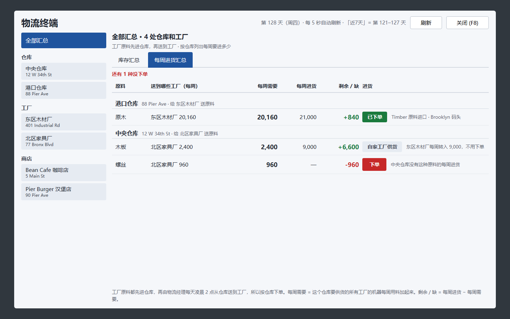
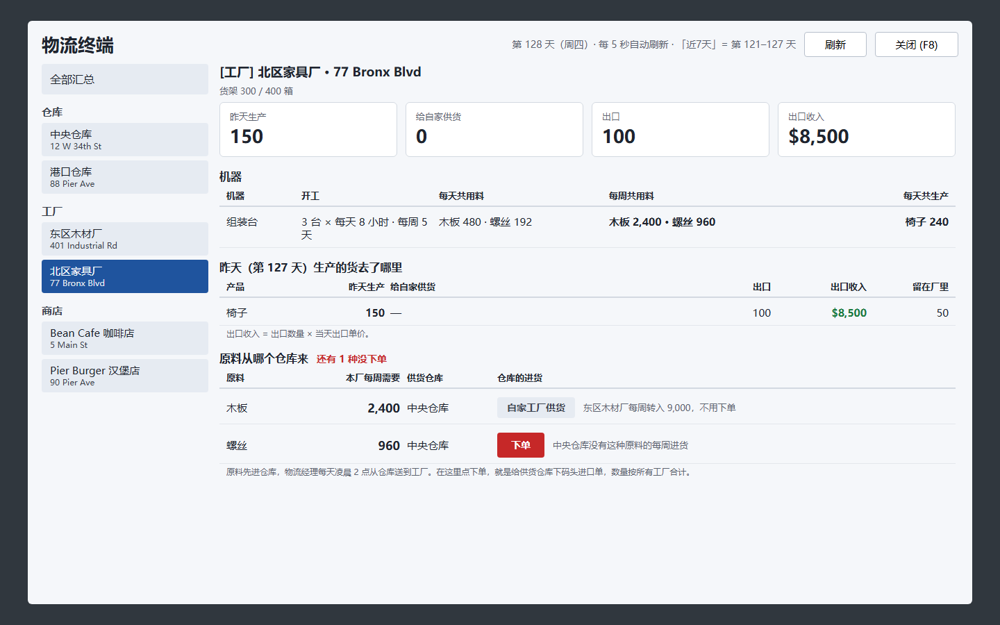
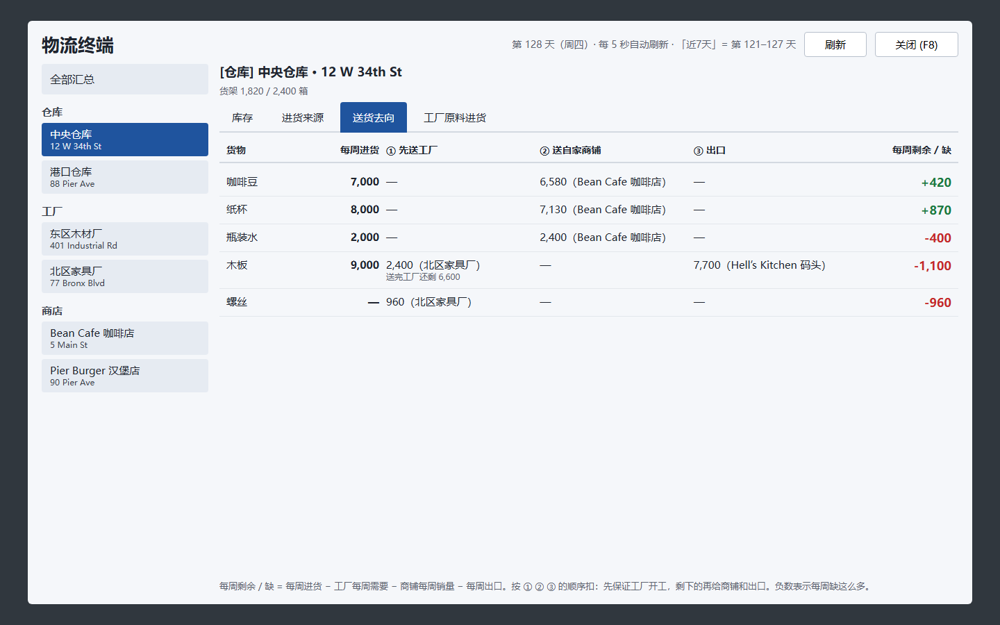
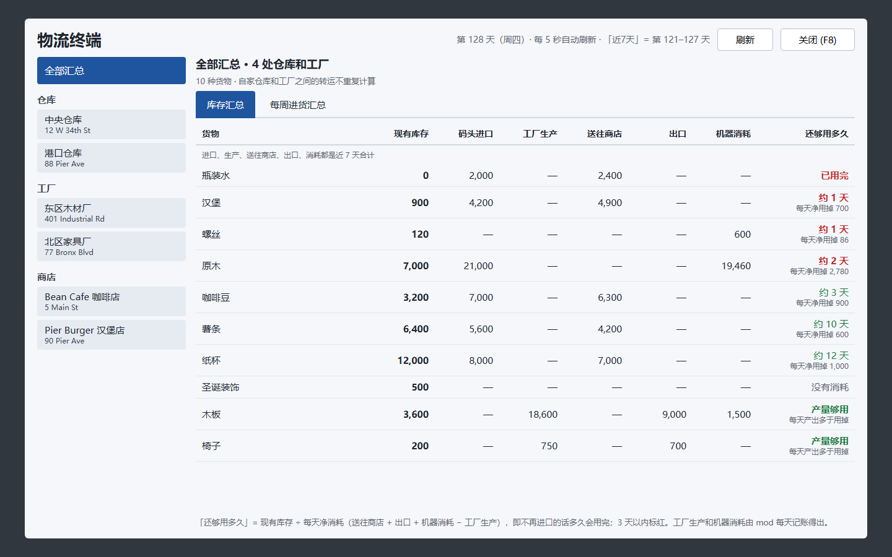

# 物流终端 · Big Ambitions mod

[English](README.md) | **简体中文**

这是 [Big Ambitions](https://store.steampowered.com/app/1331550/Big_Ambitions/) 的一个手机 App。它把整条供应链放在一个界面里：每个仓库和工厂里有什么，货从哪来、送到哪去，每个工厂每周要多少原料，每家店卖多少。它还能一键调整进口量和商铺补货目标。

界面语言跟着游戏走：游戏是中文就显示中文，其它语言显示英文。

## 截图

截图来自设计稿，数据是虚构的。游戏内窗口的布局和截图一样。

| 每周进货汇总（按仓库） | 工厂看板 |
|---|---|
|  |  |

| 仓库：送货去向 | 商店补货 |
|---|---|
|  |  |

| 库存汇总 | 仓库：进货来源 |
|---|---|
|  |  |

## 功能

- **全部汇总**
  - 所有仓库和工厂里每种货的库存。
  - **每周进货汇总**：按仓库列出每周需要、每周进货，以及剩余或缺口。
  - **商铺补货目标**：所有店的补货目标放在一张表里。
- **仓库**
  - 库存，以及还够用多久。
  - 进货来源：码头进口、批发合同、别处转入。
  - 送货去向：先送工厂，再送自家商铺，最后算出每周剩余或缺口。
- **工厂**
  - 每组机器：每周开工多久，每天和每周用多少料，每天生产多少。
  - 昨天生产的货去了哪里：送了多少给自家、出口了多少、出口收入多少。
  - 每种原料由哪个仓库供货。
- **商店**
  - 近 7 天每天平均卖多少、单日最多卖多少。
  - 现在的补货目标、建议补货目标（单日最多卖 × 2，多备一天，送货员哪天没来也不会断货），以及判断。
- **一键操作**，执行前都会先列出要改的内容让你确认：
  - **下单 / 加量**：针对单种原料。
  - **一键按需要调整每周进货**：把进口量调到每周需要，多的减、少的补，取整到 10。
  - **按建议改补货目标**：可以只改一家店，也可以改全部。

从手机里点「物流终端」打开，或者按 **F8**。按 **Esc** 关闭。

## 原理

- **工厂原料**一律先从码头进到仓库，再由物流经理每天凌晨 2 点送到工厂，所以下单是按仓库来的。
- **每周需要** = 这个仓库供货的工厂所需的原料（配方用量 × 排班的机器小时）+ 它供货的商铺近 7 天的销量。
- **工厂产量**游戏不记录。mod 每天 0 点（早于凌晨 2 点的配送）给工厂库存拍一张快照，再结合配送记录算出产量。装好后要过两次午夜才有数。快照保存在 `%USERPROFILE%\AppData\LocalLow\Hovgaard Games\Big Ambitions\LogisticsTerminal\`。
- **出口量和出口收入**直接读游戏的记录。
- **下单**修改的是你**已有的**采购合同：
  - 设置这种货每周的数量和收货仓库。
  - 如果合同是暂停的或者是一次性订单，就把它启用为每周订单。
  - 遵守进口商的每周上限。
  - 不会新建进口合作，因为游戏里新建合作要打电话，还要一名空闲的采购员。没有合同能进某种货时，mod 会提示你。
  - 不会改批发合同，也不会改自家工厂生产的货。

> 下单和改补货目标会像游戏菜单一样修改存档。进口在下周一送货时扣钱。第一次用之前请先存档。

## 安装

### Steam 创意工坊
即将上线。

### 手动安装
1. 从 [Releases](../../releases) 下载 `LogisticsTerminal.dll`，或者按下面的步骤自己编译。
2. 放到这个目录：
   ```
   %USERPROFILE%\AppData\LocalLow\Hovgaard Games\Big Ambitions\ModsLocal\LogisticsTerminal\
   ```
3. 启动游戏。本地 mod 始终启用。

## 从源码编译

需要先装好 [.NET SDK](https://dotnet.microsoft.com/download)（6 或更新）和游戏本体。项目引用游戏自带的程序集来编译，这些程序集不在仓库里。

```sh
dotnet build -c Release
# 游戏不在默认的 Steam 目录时：
dotnet build -c Release -p:GameDir="D:\SteamLibrary\steamapps\common\Big Ambitions"
```

编译完成后会自动把 DLL 复制到 `ModsLocal\LogisticsTerminal`。

### 代码结构

| 文件 | 作用 |
|---|---|
| `src/TerminalMod.cs` | mod 入口（Big Ambitions 官方 mod API），F8 快捷键 |
| `src/PhoneButtonInjector.cs` | 在游戏手机里添加 App 按钮 |
| `src/TerminalWindow.cs` | 窗口（IMGUI，按屏幕像素绘制） |
| `src/GameData.cs` | 从存档读取仓库、工厂、商店、合同和物流计划 |
| `src/ImportOrdering.cs` | 下单、加量、按需要调整进口，以及修改商铺补货目标 |
| `src/Ledger.cs` | 每天 0 点给工厂库存拍快照，用来算产量 |
| `src/Lang.cs` | 中英文文字 |

## 兼容性

基于 Unity 2022.3 版本的 Big Ambitions 和官方 mod 加载器开发和测试。游戏更新如果改了内部字段名，mod 可能会失效。遇到问题请提 issue，并附上 `Player.log` 里带 `LogisticsTerminal` 的那几行。

## 许可证

[MIT](LICENSE)。这是玩家制作的 mod，与 Hovgaard Games 没有关联，也未经其认可。
