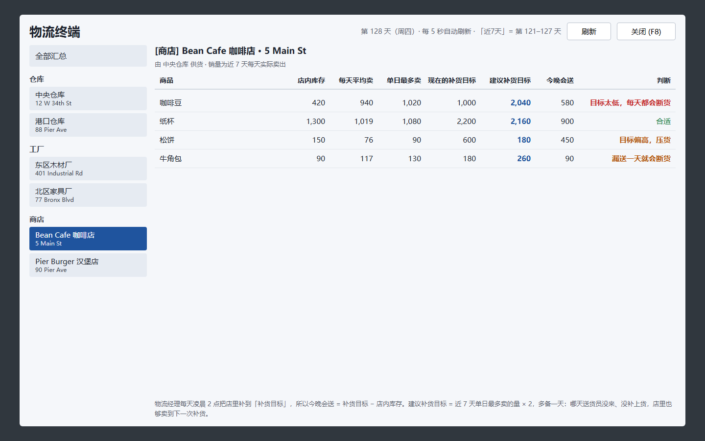
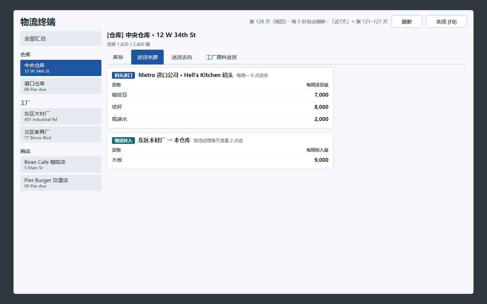

# 物流终端 · Big Ambitions mod

[English](README.md) | **简体中文**

物流终端是 [Big Ambitions](https://store.steampowered.com/app/1331550/Big_Ambitions/) 的一个 mod。它在游戏手机里加了一个 App。这个 App 在一个界面里显示整条供应链。

App 显示以下内容：

- 每个仓库和工厂的库存。
- 货物从哪里来，送到哪里去。
- 每个工厂每周需要的原料。
- 每家商店的销量。

App 也能一键修改进口量和商店补货目标。

App 的文字跟随游戏语言。游戏语言是中文时，App 显示中文。游戏是其它语言时，App 显示英文。

## 截图

截图来自设计稿。数据是虚构的。游戏内窗口的布局和截图一样。

| 每周进货汇总（按仓库） | 工厂看板 |
|---|---|
|  |  |

| 仓库：送货去向 | 商店补货 |
|---|---|
|  |  |

| 库存汇总 | 仓库：进货来源 |
|---|---|
|  |  |

## 功能

### 全部汇总

- **库存汇总**：所有仓库和工厂里每种货的库存。
- **每周进货汇总**：每个仓库的每周需要、每周进货和差值（±）。
- **商铺补货目标**：所有商店的补货目标，放在一张表里。

### 仓库

- **库存**：现有库存。库存还能用几天。
- **进货来源**：码头进口、批发合同、从自家其它建筑转入。
- **送货去向**：先送工厂，再送商店。表里显示每周剩余或缺口。

### 工厂

- **机器**：每组机器的开工时间、每天和每周的用料、每天的产量。
- **昨天的产量**：送给自家建筑的量、出口的量、出口收入。
- **原料**：每种原料由哪个仓库供货。

### 商店

- 近 7 天每天平均卖多少，单日最多卖多少。
- 现在的补货目标和建议补货目标。
- 建议补货目标 = 单日最多卖 × 2。多备的一天用来防止断货：送货员有一天没来，店里也不会缺货。

### 一键操作

每个操作都先列出所有改动。你确认之后，改动才生效。

- **下单 / 加量**：给仓库订一种原料。
- **一键按需要调整每周进货**：把每周进口量改成每周需要。多了就减，少了就加，取整到 10。
- **按建议改补货目标**：可以只改一家店，也可以改所有店。

### 打开和关闭

1. 打开：在手机上点「物流终端」，或按 **F8**。
2. 关闭：按 **Esc** 或 **F8**。

## 原理

### 原料

原料总是先进仓库。然后物流经理每天凌晨 2 点把原料送到工厂。所以要按仓库下单，不按工厂下单。

### 每周需要

一个仓库的每周需要由两部分组成：

- 它供货的工厂需要的原料。mod 用配方用量和机器开工时间来算。
- 它供货的商店近 7 天的销量。

### 工厂产量

游戏不记录工厂产量。所以 mod 每天 0 点记录一次工厂库存。这一步在凌晨 2 点送货之前。mod 用库存变化和配送记录算出产量。装好 mod 后过两次午夜，才会显示第一个产量。

记录保存在这个目录：

```
%USERPROFILE%\AppData\LocalLow\Hovgaard Games\Big Ambitions\LogisticsTerminal\
```

### 出口

出口量和出口收入来自游戏记录。

### 下单

下单会修改你**已有的**一份采购合同。mod 做以下几步：

1. 设置这种货的每周数量和收货仓库。
2. 如果合同已暂停或是一次性订单，就把它启用为每周订单。
3. 数量不超过进口商的每周上限。

mod 不会新建进口合作。在游戏里，新建合作要打电话，还要一名空闲的采购员。如果没有合同能进某种货，mod 会提示你。

mod 不改批发合同。mod 也不为自家工厂生产的货下单。

> **注意：**下单和修改补货目标会改动存档。下周一送货时会扣钱。第一次使用这些操作前，请先存档。

## 安装

### Steam 创意工坊

创意工坊版本还没有上线。

### 手动安装

1. 从 [Releases](../../releases) 下载 `LogisticsTerminal.dll`。你也可以自己编译，见[从源码编译](#从源码编译)。
2. 把 DLL 放到这个目录：
   ```
   %USERPROFILE%\AppData\LocalLow\Hovgaard Games\Big Ambitions\ModsLocal\LogisticsTerminal\
   ```
3. 启动游戏。游戏会自动加载本地 mod。

## 从源码编译

需要准备：

- [.NET SDK](https://dotnet.microsoft.com/download)，版本 6 或更高。
- 已安装的 Big Ambitions。项目引用游戏自带的程序集来编译。本仓库不包含这些程序集。

操作步骤：

1. 在项目目录打开终端。
2. 运行这条命令：
   ```sh
   dotnet build -c Release
   ```
3. 如果游戏不在默认的 Steam 目录，在命令里加上游戏目录：
   ```sh
   dotnet build -c Release -p:GameDir="D:\SteamLibrary\steamapps\common\Big Ambitions"
   ```

编译完成后，DLL 会自动复制到 `ModsLocal\LogisticsTerminal`。

### 源文件

| 文件 | 作用 |
|---|---|
| `src/TerminalMod.cs` | mod 入口。使用 Big Ambitions 官方 mod API。设置 F8 快捷键。 |
| `src/PhoneButtonInjector.cs` | 在游戏手机里添加 App 按钮。 |
| `src/TerminalWindow.cs` | 绘制窗口。按屏幕像素用 IMGUI 绘制。 |
| `src/GameData.cs` | 从存档读取仓库、工厂、商店、合同和物流计划。 |
| `src/ImportOrdering.cs` | 下单和修改进口量。修改商店补货目标。 |
| `src/Ledger.cs` | 每天 0 点记录工厂库存，用来算产量。 |
| `src/Lang.cs` | 存放中文和英文文字。 |

## 兼容性

mod 适用于 Unity 2022.3 版本的 Big Ambitions 和官方 mod 加载器。游戏更新可能会改内部字段，这会让 mod 失效。

遇到问题请提交 issue。请附上 `Player.log` 里含有 `LogisticsTerminal` 的那几行。

## 许可证

本项目使用 [MIT](LICENSE) 许可证。

这个 mod 由玩家制作。Hovgaard Games 没有参与制作，也没有认可这个 mod。
